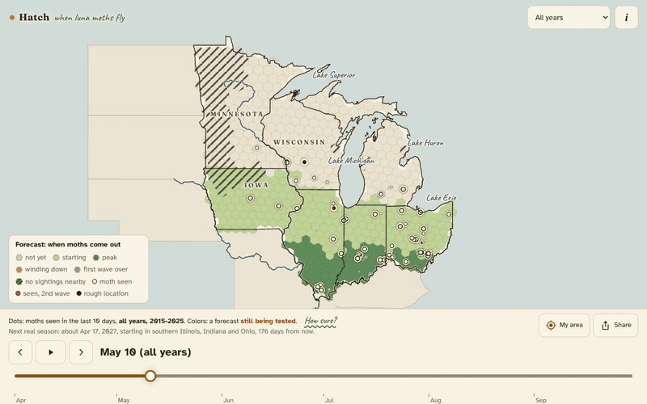
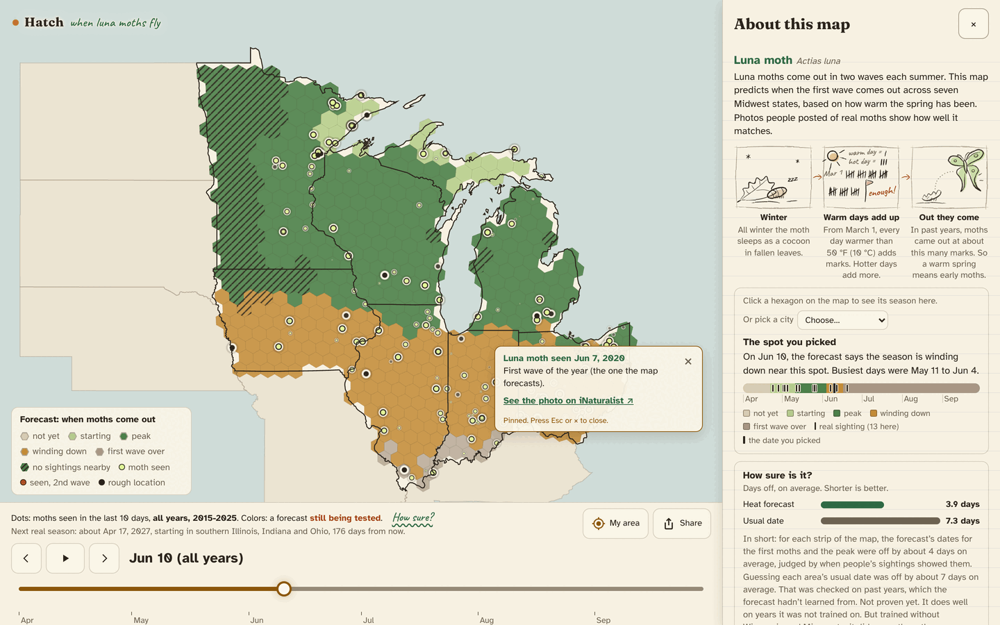
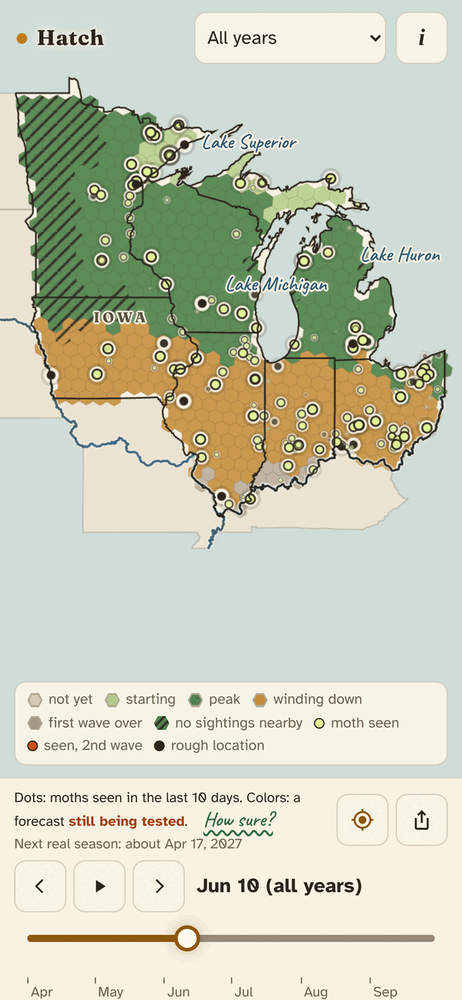
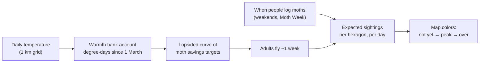
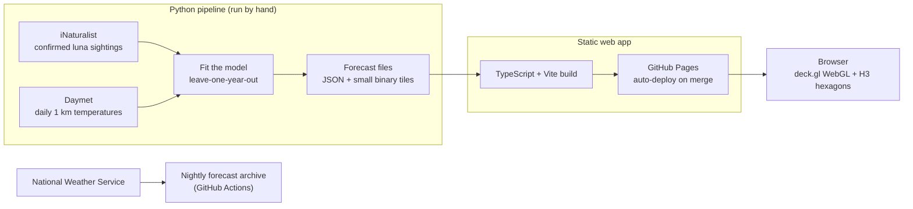

# Hatch

**When will luna moths fly near you?** Hatch is a map of the US Midwest that forecasts when the luna moth comes out each spring, built from 11 years of public sightings and daily temperatures, and checked against years it never saw.

**Try it: [neevliberman.github.io/hatch](https://neevliberman.github.io/hatch/)** (works on phones too).

TypeScript, deck.gl (WebGL) and Python. Tested in Chrome, Firefox and Safari engines and on phone sizes on every pull request.



*Hexagons are the forecast, dots are real moths people photographed. Spring warmth sweeps north from Illinois and Ohio to Minnesota, and the moths follow.*

**Live season (new).** From 2 March 2027 a nightly GitHub Action (`.github/workflows/live-forecast.yml`) rebuilds this season's forecast from real weather so far + a 7-day forecast + past years' weather run forward, and the map's **live** season shows it with a mark on the last day of real weather, this year's sightings and an "as of" badge that turns amber if the data goes stale. Until then the live season shows a 2026 dry run (`pipeline/live/DRYRUN_2026.md`). How it works: `pipeline/live/README.md`.

**Live scorecard.** Each night's forecast is archived and graded strip by strip once that strip's first wave is over and its sightings have settled for 14 days, against the usual calendar date (`pipeline/live/scorecard.py`). Rehearsed on 2026 with forecasts rebuilt as they would have stood each Monday morning: **5.6 days off on average against 8.2 for the calendar**, over 5 strips, with the far south the big miss ([SCORECARD_2026.md](pipeline/live/SCORECARD_2026.md)). The app shows it in "How sure?".

## What you can do with it

- **Press play** and watch a season: the forecast wave (hexagons) and the real sightings (dots) move north together.
- **Pick a year** from 2015 to 2025, or "all years" pooled into one typical season.
- **Pick a species** from the menu by the title: the luna moth, the common eastern firefly or the Japanese beetle (an invasive beetle, so knowing when it comes out lets gardeners hand-pick the first ones instead of spraying). The firefly and the beetle are exploratory first tries with luna's model: leave-one-year-out, the beetle's forecast is 2.9 days off against 3.8 for its usual date ([pipeline/species](pipeline/species/README.md)), the firefly's 3.7 against 5.4 ([pipeline/firefly](pipeline/firefly/README.md)). Each one's data loads only when picked.
- **Hover or tap a hexagon** for its forecast: when the first moths show up and the busiest days.
- **Tap a dot** to see that sighting and open the original photo on iNaturalist.
- **My area** jumps to the forecast where you are (location stays in your browser). **Share** copies (or, on phones, shares) a link to the same place, season and day.
- **Install it:** on a phone, *Share → Add to Home Screen* (iPhone) or *Install app* (Android) puts a hand-drawn moth on your home screen. After one visit it opens with no signal too.
- **"How sure?"** is always on screen and opens the honest version: how far off the forecast is, and what it can't do yet.

| Desktop | Phone |
|---|---|
|  |  |

## How the forecast works

**Picture a bank account for warmth.**

1. All winter the moth waits as a cocoon in fallen leaves.
2. From 1 March, every day warmer than 10 °C (50 °F) pays into the account. Hotter days pay more. Biologists call this unit a **degree-day**.
3. Each moth has its own savings target. When its balance reaches the target, it comes out. Half of them are out by about 210 to 220 degree-days, with a long tail of late ones.
4. An adult flies for about a week, and people log moths unevenly (more on weekends and during National Moth Week). So the map forecasts when *sightings* should happen, which is exactly what can be checked against real photos.



The curve's shape is learned from the data: the model tries many curve shapes and keeps the one that best explains the real sighting dates (maximum likelihood). A warm spring fills the account early, so moths come early, and the map shows it.

## How good is it

The test is **leave-one-year-out**: to grade the forecast for 2019, the model is fit on the other ten years only, then asked to call 2019's first moths and peak. It is like grading a student on a test they have not seen. The baseline to beat is each area's usual date.

| Way of guessing the date | Average days off (lower is better) |
|---|---|
| The usual calendar date for that area | 7.3 days |
| Hatch's first model (a quick prototype in a notebook) | about 4.0 days |
| **Hatch's current model** | **about 3.9 days** |
| A perfect forecaster, given how noisy the sightings are | about 3.0 days |

- **It cuts the usual date's error from 7.3 to about 3.9 days.** The true gain could be as small as 1 day or as large as 5 (95% confidence interval). Scored on 31 test cases, each one east-west band of the map in one year, across seven states.
- **It ties the first model on accuracy.** The gain over that model is the next point, not fewer days off.
- **It mostly fixed a bias.** An earlier version called the south about 6 days too early and the north 4 days too late. The current model is within about 4 days in every strip, mostly leaning a little late.
- **The rules were written down before scoring** ([FROZEN_P3.md](pipeline/fit/FROZEN_P3.md)), and both runs are reported, including the one that went worse. Full numbers: [pipeline/fit/RESULT.md](pipeline/fit/RESULT.md).

## What it can't do yet

- **It has never forecast a season live.** Every score above is a replay of past years using that year's real temperatures. The first true test is the 2026 season, once its temperature data is published (around mid-2027).
- **Unseen places are shaky.** The model picked in advance failed a test where it learned on Illinois, Indiana and Ohio and guessed Wisconsin and Minnesota (7.4 days off). A simpler version does pass that test (5.1 days), but it was picked after seeing the failure, so it counts as a second look, not proof.
- **Sightings are not moths.** The model sees when people photograph moths, not when moths emerge. It corrects for when people are out looking, but that correction could also soak up real changes in moth numbers.
- **Accuracy is measured for whole latitude strips**, not single hexagons. Zoomed-in hexagons (down to about 6 km) use local temperatures, but nobody has scored them one by one.
- **First wave only.** Lunas have a second summer wave in the south. It is shown as dots, not forecast.

## How it's built



- **Front end:** TypeScript, [deck.gl](https://deck.gl/) on WebGL, [H3](https://h3geo.org/) hexagons, Vite. No framework and no map tile server: state outlines are bundled, and lakes, rivers, highways, forests, woods (as little tree marks) and town names come from three small self-hosted files, so the app makes no outside requests. Scrubbing the timeline changes one number on the graphics card (a shader setting) instead of re-sending 3,000 dots, so it stays smooth on phones.
- **Model and data:** Python (NumPy, SciPy, pandas). The fitter is tested by planting known values in a fake Midwest and checking it finds them again.
- **Testing:** every pull request runs Playwright smoke tests (quick checks that the app loads and works) on phone sizes (iPhone and Android, portrait and landscape) and desktop sizes in Chromium, Firefox and WebKit. They fail on any page error, a blank map, a covered or off-screen button, or a broken keyboard path. A first-frames check films the first seconds of load and fails on a stretched or misplaced first map frame, and every pull request also gets a visual review of its screenshots ([CONTRIBUTING.md](CONTRIBUTING.md)). `npm run check` also enforces a size limit: the whole app, in one file, stays under 500 KB compressed.
- **Accessibility:** text meets WCAG 2.1 AA contrast, map marks meet 3:1, everything works by keyboard, and the map has a screen-reader summary.
- **Forecast archive:** the National Weather Service keeps no old forecasts, so a nightly job saves them now for testing future live forecasts.

More detail on the design choices (the layer plug-in contract, the single clock, why hexagons): [docs/engineering.md](docs/engineering.md).

## Run it locally

```
npm install
npm run dev          # http://localhost:5173
npm run build        # type-check + dist/
npm run build:single # one self-contained dist-single/index.html (opens with no network)
npm run check        # both builds, bundle budget and all smoke tests
npm run icons        # app icons + favicon PNGs from public/icons/hatch.svg and public/favicon.svg (both drawn by scripts/logo.mjs)
npm run og           # the link-preview card, public/og.png (a real map screenshot)
```

The Python side: `pip install -r notebooks/requirements.txt`, then see [pipeline/fit/README.md](pipeline/fit/README.md) and [pipeline/replay/README.md](pipeline/replay/README.md). [RUNBOOK.md](RUNBOOK.md) covers the screenshot tests and deploys.

## Repo layout

```
src/              the web app (core/ clock and hex grid, layers/ the luna layer and the one-generation layer, map/, ui/)
src/species.ts    the species list behind the species menu; src/species/ each species's words and sketch
pipeline/fit/     the model, its tests and the scored result
pipeline/replay/  builds the forecast files the app reads
pipeline/firefly/ the firefly's data and fit
pipeline/species/ every further species (Japanese beetle so far): one list, one fetch/fit/fine-hex recipe
pipeline/basemap/ builds the map detail (lakes, rivers, highways, forests, woods) from public-domain data
pipeline/live/    nightly live forecast -> live/latest.json (PRISM + Open-Meteo + Daymet, frozen P3 fits)
.github/workflows/live-forecast.yml  the nightly live job, 2 Mar-7 Oct
notebooks/        the first prototype model (Jupyter notebook)
scripts/          smoke tests, bundle budget, data build helpers
docs/             engineering notes and README media
```

## Data and credits

- **Sightings:** [iNaturalist](https://www.inaturalist.org/taxa/47916-Actias-luna) observers. Only CC0, CC BY and CC BY-NC records are shown or redistributed, so the app's data carries those observers' licenses (non-commercial terms apply). The model also learned from the dates and places of other confirmed records, which are not shipped. Photos are linked, never copied, and every shown record keeps its observation id.
- **Temperatures:** [Daymet](https://daymet.ornl.gov/) v4 daily 1 km data, Thornton et al., ORNL DAAC.
- **State outlines, town names and populations:** US Census Bureau (outlines via [us-atlas](https://github.com/topojson/us-atlas)). Public domain.
- **Lakes, rivers, highways, national parks and the land beyond the US:** [Natural Earth](https://www.naturalearthdata.com/). Public domain.
- **National forests:** [US Forest Service](https://data.fs.usda.gov/geodata/edw/datasets.php). Public domain.
- **Woods (deciduous and mixed forest):** [USGS National Land Cover Database 2021](https://www.mrlc.gov/). Public domain.
- **Fonts:** Fraunces, Atkinson Hyperlegible and Caveat, under the SIL Open Font License.

**License:** the code is [MIT](LICENSE). The data keeps its own terms above. The sighting files (`src/data/luna-replay.json`, `public/firefly-replay.json`, `public/species/*/replay.json`) mix CC0, CC BY and CC BY-NC records, so attribution and non-commercial terms apply to them. The fonts stay under the SIL Open Font License.

## Who made it

Neev Liberman, a mobile front-end engineer with a wet-lab genetics background. Hatch started as a way to put evolutionary biology, real data and an interactive map in one place.
