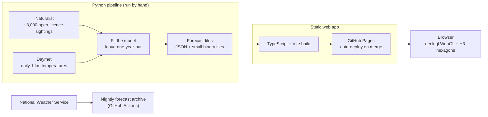

# Hatch

**When will luna moths fly near you?** Hatch is a map of the US Midwest that forecasts when the luna moth comes out each spring, built from 11 years of public sightings and daily temperatures, and checked against years it never saw.

**Try it: [neevliberman.github.io/hatch](https://neevliberman.github.io/hatch/)** (works on phones too).


*Hexagons are the forecast, dots are real moths people photographed. Spring warmth sweeps north from Illinois and Ohio to Minnesota, and the moths follow.*

## What you can do with it

- **Press play** and watch a season: the forecast wave (hexagons) and the real sightings (dots) move north together.
- **Pick a year** from 2015 to 2025, or "all years" pooled into one typical season.
- **Hover or tap a hexagon** for its forecast: when the first moths show up and the busiest days.
- **Tap a dot** to see that sighting and open the original photo on iNaturalist.
- **My area** jumps to the forecast where you are (location stays in your browser). **Share** copies a link to the same place, season and day.
- **"How sure?"** is always on screen and opens the honest version: how far off the forecast is, and what it can't do yet.

| Desktop | Phone |
|---|---|
|  |  |

## How the forecast works

**Picture a bank account for warmth.**

1. All winter the moth waits as a cocoon in fallen leaves.
2. From 1 March, every day warmer than 10 °C (50 °F) pays into the account. Hotter days pay more. Biologists call this unit a **degree-day**.
3. Each moth has its own savings target. When its balance reaches the target, it comes out. Half of them are out by about 210 to 220 degree-days, with a long tail of late ones.
4. An adult flies for about a week, and people log moths unevenly (more on weekends and during National Moth Week). So the map forecasts when *sightings* should happen, which is exactly what can be checked against real photos.


The curve's shape is learned from the data by maximum likelihood: the model picks the curve that makes the real sighting dates most likely. A warm spring fills the account early, so moths come early, and the map shows it.

## How good is it

The test is **leave-one-year-out**: to grade the forecast for 2019, the model is fit on the other ten years only, then asked to call 2019's first moths and peak. Like a teacher writing the exam without seeing this year's answers. The comparison is "the calendar": each area's usual date.

| Way of guessing the date | Average days off (lower is better) |
|---|---|
| The usual calendar date for that area | 7.3 days |
| Hatch's first model (the notebook test) | 4.1 days |
| **Hatch's current model** | **about 3.8 days** |
| A perfect forecaster, given how noisy the sightings are | about 3.0 days |

- **It roughly halves the calendar's error**, about 3 days better (95% confidence interval roughly 1 to 5 days), scored over 31 latitude strip-years across seven states.
- **It ties the first model on accuracy.** The gain over that model is the next point, not fewer days off.
- **It fixed an early bias.** An earlier version called the south about 6 days too early and the north 4 days too late. The current model is within about 4 days in every strip, mostly leaning a little late.
- **The rules were written down before scoring** ([FROZEN_P3.md](pipeline/fit/FROZEN_P3.md)), and both runs are reported, including the one that went worse. Full numbers: [pipeline/fit/RESULT.md](pipeline/fit/RESULT.md).

## What it can't do yet

- **It has never forecast a season live.** Every score above is a replay of past years using that year's real temperatures. The first true test is the 2026 season, once its temperature data is published (around mid-2027).
- **Unseen places are shaky.** The first model failed a test where it learned on Illinois, Indiana and Ohio and guessed Wisconsin and Minnesota (7.4 days off). A simpler version does pass that test (5.1 days), but it was picked after seeing the failure, so it counts as a second look, not proof.
- **Sightings are not moths.** The model sees when people photograph moths, not when moths emerge. It corrects for when people are out looking, but that correction could also soak up real changes in moth numbers.
- **Accuracy is measured for whole latitude strips**, not single hexagons. Zoomed-in hexagons (down to about 6 km) use local temperatures, but nobody has scored them one by one.
- **First wave only.** Lunas have a second summer wave in the south. It is shown as dots, not forecast.

## How it's built



- **Front end:** TypeScript, [deck.gl](https://deck.gl/) on WebGL, [H3](https://h3geo.org/) hexagons, Vite. No framework and no map tile server: state outlines are bundled, so the app makes no outside requests. Scrubbing the timeline changes one GPU shader value instead of re-uploading 3,000 dots, so it stays smooth on phones.
- **Model and data:** Python (NumPy, SciPy, pandas). The fitter is tested by planting known values in a fake Midwest and checking it finds them again.
- **Testing:** every pull request runs Playwright smoke tests on phone sizes (iPhone and Android, portrait and landscape) and desktop sizes in Chromium, Firefox and WebKit. They fail on any page error, a blank map, a covered or off-screen button, or a broken keyboard path. A bundle budget keeps the one-file build under 500 KB gzipped.
- **Accessibility:** text meets WCAG 2.1 AA contrast, map marks meet 3:1, everything works by keyboard, and the map has a screen-reader summary.
- **Forecast archive:** the National Weather Service keeps no old forecasts, so a nightly job saves them now for testing future live forecasts.

More detail on the design choices (the layer plug-in contract, the single clock, why hexagons): [docs/engineering.md](docs/engineering.md).

## Run it locally

```
npm install
npm run dev          # http://localhost:5173
npm run build        # type-check + dist/
npm run build:single # one self-contained dist-single/index.html (opens with no network)
npm run check        # both builds, bundle budget and all smoke tests
```

The Python side: `pip install -r notebooks/requirements.txt`, then see [pipeline/fit/README.md](pipeline/fit/README.md) and [pipeline/replay/README.md](pipeline/replay/README.md). [RUNBOOK.md](RUNBOOK.md) covers the screenshot tests and deploys.

## Repo layout

```
src/              the web app (core/ clock and hex grid, layers/ the luna layer, map/, ui/)
pipeline/fit/     the model, its tests and the scored result
pipeline/replay/  builds the forecast files the app reads
notebooks/        the first go/no-go notebook test
scripts/          smoke tests, bundle budget, data build helpers
docs/             engineering notes and README media
```

## Data and credits

- **Sightings:** [iNaturalist](https://www.inaturalist.org/taxa/47916-Actias-luna) observers. Only CC0, CC BY and CC BY-NC records are used, so the derived data carries those observers' licences (non-commercial terms apply). Photos are linked, never copied, and every record keeps its observation id.
- **Temperatures:** [Daymet](https://daymet.ornl.gov/) v4 daily 1 km data, Thornton et al., ORNL DAAC.
- **State outlines:** US Census Bureau, via [us-atlas](https://github.com/topojson/us-atlas).
- **Fonts:** Fraunces, Atkinson Hyperlegible and Caveat, under the SIL Open Font License.

## Who made it

Neev Liberman, a mobile front-end engineer with a wet-lab genetics background. Hatch started as a way to put evolutionary biology, real data and an interactive map in one place.
