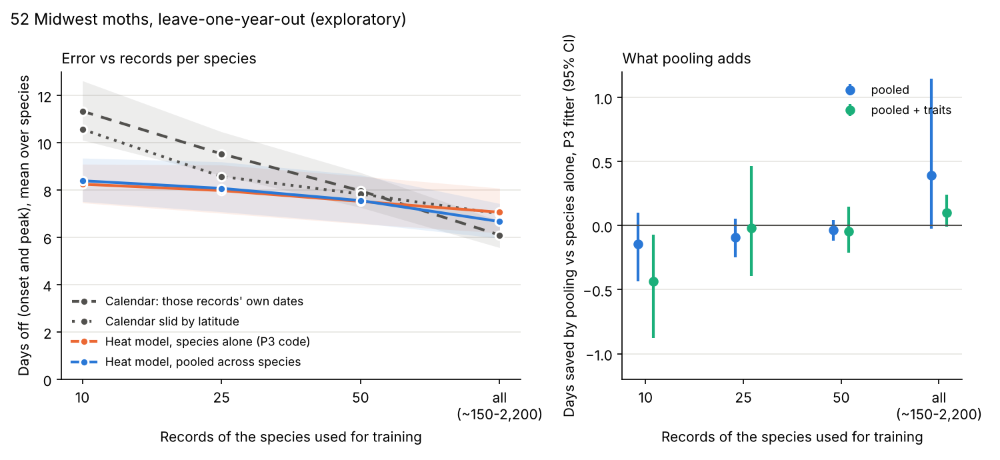

# Pooled moth model: a first look (exploratory, 2026-10-24, revised after review)

**This is exploratory research, not a pre-registered test.** I wrote the species rules and the design before fitting, but nothing was frozen and reviewed the way P3 was ([FROZEN_P3.md](../../pipeline/fit/FROZEN_P3.md)). Nothing on the map changes.

There have been two runs. Run 1 was the first full run. Run 2 is this one, after review (PR #54). The one method change: fits stuck at a parameter bound no longer feed the shared prior (see "Revision" below). Run 1's headline was a 0.17-day pooling gain. That number was measured against a baseline the table didn't show, and it was partly an artefact of those stuck fits. It does not survive.

**The question.** The build plan's season-two idea is a model pooled across ~100 moths ("the real ML upgrade"). A review estimated that 150-250 species could get their own model and that pooling could add another 350-450. The idea is that data-poor species borrow strength from data-rich ones. Does that work on real Midwest data?

**Short answer: no, not in this form.**
- **Pooling does not help data-poor species forecast.** At 10 records, the pooled model is 0.15 days *worse* than P3's own fitter used species by species (95% CI 0.10 better to 0.43 worse). It ties at 25 and 50 records. Adding traits (family, size, voltinism, larval food) makes it worse at 10 records: 0.44 d worse, CI 0.07 to 0.88.
- **It does make data-poor curves sensible.** With 10 records, 62% of P3-fitter curves have their skew stuck at the limit. Pooled, none do. The dates just don't move.
- **With all records, the heat model doesn't beat the calendar on average** for these moths.
  - P3's fitter used species by species is 1.0 day worse than each species' own calendar (7.1 vs 6.1 days off, CI 0.2 to 2.0 worse).
  - Pooled, it is 0.6 days worse (6.7 d, CI 0.0 to 1.2 worse).
  - Heat wins for 21 of the 50 scored species (22 pooled). Luna is one of them.
- **Heat does win when records are few.** With 10 records it beats the best calendar from the same records by 2.3 days (8.3 vs 10.6, CI 1.6 to 3.1). By 25-50 records that gap is within noise.
- **Species estimate:** **at most about 30 moth species** look likely to get an honest heat forecast from this approach. That is an upper bound; the derivation is below. It is well under the review's 150-250, and the review's +350-450 from pooling is not supported.



*Left: average days off (onset and peak) for each way of guessing, against how many of a species' records it learned from. Right: days saved by pooling compared with P3's fitter on the species alone (below 0 means pooling is worse), with 95% intervals across species.*

## The numbers

Leave-one-year-out over 2015-2025. There were 651 scored band-years (latitude strip × year with ≥ 20 records) across 50 of the 52 species. Each score is the mean days off for onset (10th-percentile day) and peak (median day), averaged within each species and then across species. With 10/25/50 records, I drew 2 random subsamples from the training years and averaged them. "All" means 150-2,200 first-brood training records per species.

| Records used for training | 0 | 10 | 25 | 50 | all |
|---|---|---|---|---|---|
| Calendar: those records' dates, per latitude strip | – | 11.3 d | 9.5 d | 8.0 d | **6.1 d** |
| Calendar: those records' dates, slid by latitude | – | 10.6 d | 8.6 d | 7.8 d | 7.0 d |
| Heat model, species alone, P3's fitter (P3.1 bounds) | – | **8.3 d** | **8.0 d** | **7.5 d** | 7.1 d |
| Heat model, species alone, this code's fitter | – | 8.4 d | 8.1 d | 7.6 d | 7.2 d |
| Heat model, pooled across species | 17.8 d | 8.4 d | 8.1 d | 7.6 d | 6.7 d |
| Heat model, pooled, prior shaped by traits | 19.9 d | 8.7 d | 8.0 d | 7.6 d | 7.0 d |
| *Pooled minus P3's fitter (95% CI)* | | *+0.15 (−0.10 to +0.43)* | *+0.09 (−0.05 to +0.25)* | *+0.04 (−0.04 to +0.12)* | *−0.39 (−1.15 to +0.02)* |
| *P3's fitter minus best calendar (95% CI)* | | *−2.3 (−3.1 to −1.6)* | *−0.6 (−1.4 to +0.3)* | *−0.3 (−1.2 to +0.7)* | *+1.0 (+0.2 to +2.0)* |

The best calendar is the latitude-slid one at 10, 25 and 50 records, and the per-strip one with all records. Two fitters appear because the pooled model reparametrises the curve (median target, spread, skew). Its no-prior version ("this code's fitter") isolates what the prior does: pooled minus it is +0.01 / −0.01 / −0.01 / −0.52 d. P1's empirical heat model scores 10.0 / 8.6 / 8.2 / 7.7 d. Everything is in `results/summary.json`; per-species scores are in `results/per_species.csv`.

## What it means, in plain words

- **Think of each species as a bank account with a savings target.** Pooling assumes the targets of all moths come from one shared spread, so a new species' first few receipts get averaged with what is typical. That only helps if moths are alike, and they aren't very alike here. Among the 38 species whose fit isn't stuck at a bound, the median targets run about 240-580 degree-days in the middle half, roughly a factor of 2 either way (SD 0.69 on the log scale). Traits don't narrow that at all (SD 0.69). The curve's skew varies even more (SD 2.7).
- **Ten records already pin a species' timing.** What they can't pin is the curve's *shape* (how long the tail of late moths is). Pooling fixes the shape. The forecast dates depend mostly on timing, so they don't improve. The synthetic test in `test_pooled.py` shows the same thing: pooling improves the planted curve's 10/50/90% targets but not its median.
- **Many moths fit a flat curve.** For 14 of 52 species, a single heat curve fitted to all their records sits on a bound: the median target at 5 degree-days or the spread at 800. These are mostly long-flying or many-brooded moths with no clean first brood, such as *Hemaris thysbe*, *Microcrambus elegans*, *Dryocampa rubicunda* and *Darapsa myron*. A first-emergence warmth model is the wrong shape for them.
- **Heat beats the calendar when data are thin**, because warmth carries information across years and latitudes that 10 dates can't. With all records the species' own calendar wins on average. Heat wins clearly for *Phalaenophana pyramusalis*, *Lymantria dispar*, *Trichodezia albovittata*, *Eubaphe mendica* and luna. It loses badly for *Argyrotaenia velutinana*, *Dryocampa rubicunda*, *Paonias excaecata* and *Automeris io*.
- **Luna here vs P3.** Luna scores 6.7 d (heat) vs 8.0 d (calendar) in this run, worse than P3's 3.9 vs 7.3. This run differs from P3 in its data and scoring: adult-annotated, openly licensed records only; no year effect; flat model; a different calendar rule; and every band-year with ≥ 20 records scored. So the two numbers can't be compared directly.
- **Zero records doesn't work.** Forecasting a species from the shared prior alone is 18-20 days off.

## What it would take to add N species to the map

Census (`results/census.json`): Midwest moth species by research-grade, adult-annotated, openly licensed records 2015-2025. Counts are scaled by 0.69, the median share that survives cleaning and the 1 March-28 August window. That share is taken over all 82 downloaded species, selected or not.

| Records after cleaning | ≥ 50 | ≥ 100 | ≥ 200 | ≥ 400 | ≥ 1,000 |
|---|---|---|---|---|---|
| Moth species (of ~2,000) | ~693 | ~485 | ~275 | ~125 | ~41 |

**The upper bound of about 30 species with an honest heat forecast** = 125 species with ≥ 400 cleaned records × 0.57 × 0.42.
- **0.57 is the selection pass rate.** Of 91 candidates at that size, 15 were left out by name (migrants, adults that overwinter, indoor moths) and 24 failed the flight-season rules; 52 passed.
- **0.42 is the share of scored species where heat beat the calendar:** 21 of 50.
- **It is an upper bound** because picking species on one noisy leave-one-year-out win overstates how often they would win again (winner's curse).
- **The 200-400-record group is untested.** It would score no better, since less data helps the calendar as much as the model.

What adding a species would need:
1. **A per-species gate.** Run this leave-one-year-out for every candidate, and keep only species that beat their own calendar. Ideally check them again on 2026, a season none of this has seen.
2. **Forget data-poor species as map layers.** With 25-100 records the heat model is still about 8 days off and no better than the slid calendar.
3. **Hand review.** The name list of migrants, adult overwinterers and indoor moths (`fetch.py`) has to grow with N. The trait table (`traits.csv`) was typed from memory and is approximate. It didn't help, so it can be dropped.
4. **Cost.**
   - Downloads: about 3 minutes per 1,000 records at iNat's polite rate.
   - Daymet: already covers the region (597 res-4 hexes).
   - Fitting: about 1 hour wall-clock for 52 species × 11 folds on a busy 4-core box.
   - Map: per-species replay files of luna's size (~270 KB) would be lazy-loaded, as fireflies already are.
5. **Better bets than pooling.** Separate broods for many-brooded moths. A daylength-triggered model for species where heat loses.

## How it was done

- **Species** ([select.py](select.py), [species.csv](species.csv)):
  - I ranked moths by research-grade, adult-annotated, CC0 / CC BY / CC BY-NC iNat records in WI IL MN IA MI IN OH, 2015-2025.
  - [fetch.py](fetch.py) has a 24-name exclusion list. 15 of those names were among the ranked candidates.
  - Two of them, *Hypena scabra* and *Emmelina monodactyla*, were added to the list after the first download had started but before any fit. They were downloaded anyway, and select.py drops them ("adult overwinters" in species.csv).
  - Kept: species with ≥ 400 cleaned records by 28 Aug, a median sighting day between 10 May and 24 Jul, and ≥ 70% of records in that window.
  - Result: 52 species from 10 families, 57,500 records, 597 hexes. Raw downloads stay in `notebooks/data/` (gitignored).
- **Model** ([pooled.py](pooled.py)): P3's likelihood, imported unchanged from `pipeline/fit/model.py`. That means skew-normal warmth targets, base 10 °C from 1 March, a 7-day flight, the state moth-effort background, 1% contamination, observer weights and brood cut-offs per fold. There is no latitude, daylength or year term. Photoperiod sensitivity was not pooled.
- **Pooling, by empirical Bayes.**
  1. Fit each *other* species alone, with uncertainty from the Laplace approximation.
  2. Learn a shared Gaussian over (log median target, log spread, skew), optionally with the log median depending on traits.
  3. Refit the target species with that Gaussian as its prior.

  The prior never sees the target species or the held-out year. numpyro/PyMC weren't installed. A full Bayesian fit would mostly change the intervals, not these point forecasts.
- **Revision after review.**
  - In run 1, 10 species (18% of fold fits) sat at the 5-degree-day lower bound on the median. They fed the shared prior and made "moths aren't alike" look stronger than it is.
  - Fits on the median's lower bound or the spread's upper bound are now flagged (`pooled.pinned`) and left out of the prior. They are still forecast and scored. That covers 14 of 52 species on all years and 29% of fold fits.
  - The prior is now tighter (log-median SD 0.69, not 1.4). The pooling result did not get better.
  - One species sits just above the bound (5.01 DD) and isn't flagged by the 0.001 tolerance.
- **Speed.** The skew-normal CDF is tabulated once over (z, skew) and used by every arm, including P3's fitter. Its error is under 2e-4 (measured 1.4e-5), checked by `test_fast_cdf_matches_exact`.
- **Tests** ([test_pooled.py](test_pooled.py)):
  - the table CDF matches the exact one;
  - bound flags work;
  - the reparametrisation round-trips;
  - the reparametrised fit matches P3's fitter;
  - simulate-and-recover shows pooling improves curves planted from a shared distribution.

**Known weak spots.**
- The data-poor test subsamples data-rich species. Truly rare species may differ.
- Brood cut-offs and the hex weights that define each band-year come from the full training set in every arm, a small leak shared by all arms.
- The effort background includes the target species itself.
- 2015-2017 contribute few scored band-years.
- One analysis run per design. The run 2 change was prompted by review, after run 1's results were seen.

## Rerun
```
pip install -r notebooks/requirements.txt    # Python 3.13
python3 notebooks/pooled/fetch.py        # ~40-80 min of polite iNat calls + Daymet, cached in notebooks/data/
python3 notebooks/pooled/select.py       # species.csv            (needs fetch.py's raw parquets)
python3 notebooks/pooled/census.py       # results/census.json    (needs species.csv + fetch.py's caches)
python3 notebooks/pooled/run.py          # ~1-2 h: results/rows.csv.gz, fits.csv.gz, params_all_years.csv, run.json
                                         #   (needs the raw parquets, Daymet cache and effort file; its process
                                         #    pool uses fork, so Linux/macOS only, not Windows)
python3 notebooks/pooled/report.py       # results/summary.json, per_species.csv, figures/pooled_vs_n.png
python3 -m pytest -q notebooks/pooled    # 0.5-4 min depending on load, no network
```
