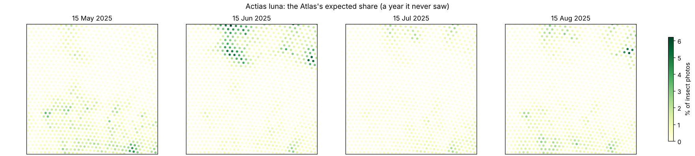
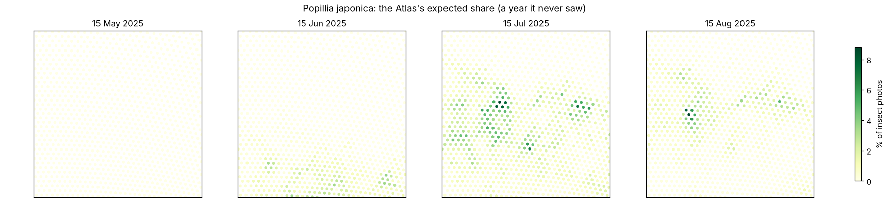
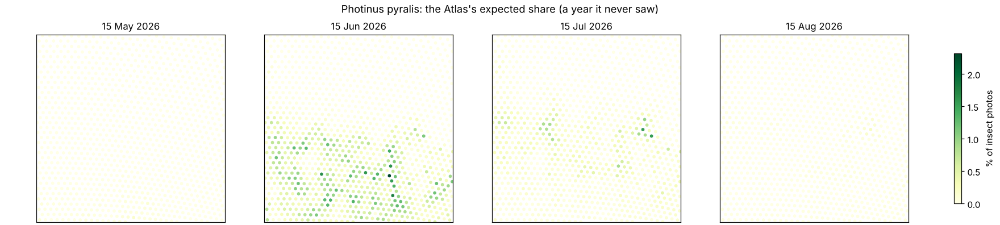
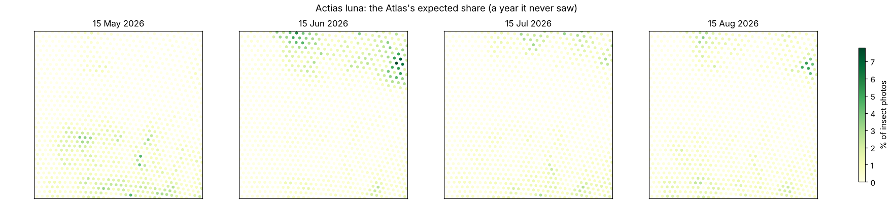

# Living Atlas gate

**Verdict: GO.** With two bugs in the luna check fixed (amendment 2, found by an independent review), run 1 passes
all three of its originally frozen checks, scored on 2025 against P3 like-for-like. Run 2 repeats the result on
2026, a season no step had touched.

| Check | Run 1: 2025 (as frozen) | Run 2: 2026 (amendment 1) |
|---|---|---|
| Species beating their own calendar, training states | **620 of 652 (95%)** | **753 of 798 (94%)** |
| Species beating their own calendar, Wisconsin + Minnesota (never seen) | **325 of 553 (59%)** | **251 of 433 (58%)** |
| All records, log-likelihood per record: Atlas vs calendar (training states) | −5.37 vs −5.65 | −5.43 vs −5.73 |
| All records: Atlas vs calendar (WI/MN) | −5.61 vs −5.98 | −5.72 vs −6.24 |
| Luna onset/peak, mean days off (5 strips), bugs fixed | **4.5 d** vs P3 4.3 (bar 5.3) | 3.6 d vs P3's forecasts 5.5* |
| Luna, as first computed (bugs in) | 5.6 d: fail | 5.3 d |

\* Run 2 compares an Atlas hindcast on real weather with P3 forecasts issued a week ahead, and P3's 2026 score was
known when amendment 1 was written, so treat it as against forecasts, not like-for-like (amendment 2). Dates are read
from the scorecard's rounded table, so P3 scores 5.5 d here and 5.6 d in SCORECARD_2026.md.
Numbers: `results/gate.json`, `results/run2/gate.json`, `results/luna_amended.json`.

In plain words:
- **"Who's out here this week" works.** Given a place and a day, one network's share of insect photos beats each
  species' own strip-by-week calendar for about 95% of species in a year it never saw, and for about 58% in two
  states it never saw, two seasons running.
- **Luna: about as good as P3, from a model that also does 1,700-1,900 other species.** 4.5 days off on 2025 against
  P3's 4.3, both on real weather.
- **Warmth helps a little, not a lot.** See run 2 below. The blend barely moves from even; making the clock learn
  harder is the first upgrade to try, against this same scorer.
- **Known misses:** the periodical cicada (a 17-year brood, which needs a brood map), and luna onset in 43-45 °N is
  still 8-15 days late.

## Run 2 (27 Oct 2026, amendment 1, scored on 2026)

Rules: [FROZEN_ATLAS.md](FROZEN_ATLAS.md), amendment 1, committed before run 2 trained. Numbers: `results/run2/`.
Run: `python3 pipeline/atlas/run_gate.py --run2` (76 min on 4 cores). Trained on 2015-2025 (2.12 M records, 1,945
species with 100+), never shown 2026 or Wisconsin/Minnesota.

| Check | Atlas | Calendar | Pass? |
|---|---|---|---|
| C. 2026, a season no step had touched: species won | **753 of 798 (94%, CI 93-96%)** | | yes |
| C. all records, log-likelihood per record | **−5.43** | −5.73 | yes |
| D. Wisconsin + Minnesota 2026: species won | **251 of 433 (58%, CI 53-63%)** | | yes |
| D. all records | **−5.72** | −6.24 | yes |
| Luna 2026 onset/peak, mean days off (5 strips) | **5.3 d** (3.6 d with amendment 2) | 8.0 d (P3's forecasts: 5.5 d) | yes (needs ≤ 6.5 and < calendar) |

In plain words:
- **It holds up on a brand-new season.** Same story as run 1, on data nothing had seen: the network's share of
  photos beats each species' calendar for 94% of species, and for 58% in two states it never saw.
- **Luna against P3's forecasts.** 5.3 days off as first computed (3.6 with amendment 2) against P3's 5.5. The
  Atlas saw each day's real weather, while P3's numbers are forecasts issued a week ahead, so this leans its way.
- **Warmth helps a little, not a lot.** With the clock on, 2026 scores −5.43 against −5.44 without it, and 457 of
  798 species prefer it. In WI/MN the no-warmth version is slightly better (−5.70). The blend weights still barely
  move from even (median 32/33/35%), but they lean the right ways: firefly 47% warmth, Japanese beetle 41%, luna
  38%; monarch (a migrant) and the periodical cicada lean calendar. Making the clock learn harder is the first
  upgrade to try, against this same scorer.
- **Luna in 43-45 °N** looked 19 days late, but most of that was the check counting only non-WI/MN records while
  P3's target is mostly WI/MN (amendment 2). Fixed, it is 12 days late, still the worst strip.

## Run 1 (27 Oct 2026, as frozen, scored on 2025): no-go as first computed, GO with amendment 2

Rules: [FROZEN_ATLAS.md](FROZEN_ATLAS.md), committed before training. Numbers: `results/gate.json`, `results/per_species.csv`.
Run: `python3 pipeline/atlas/run_gate.py` (74 min on 4 cores).

**As first computed, the network passed both big tests by a wide margin and failed the luna check by 0.3 days. With the
check's two bugs fixed (amendment 2) luna is 4.5 days off and passes.** Warmth also hasn't earned its place yet: the same network without the warmth clock scores
the same.

| Check | Atlas | Calendar | Pass? |
|---|---|---|---|
| A. 2025, a year it never saw: species won | **620 of 652 (95%, CI 93-97%)** | | yes |
| A. all records, log-likelihood per record | **−5.37** | −5.65 | yes |
| B. Wisconsin + Minnesota, never seen: species won | **325 of 553 (59%, CI 55-63%)** | | yes |
| B. all records | **−5.61** | −5.98 | yes |
| Luna 2025 onset/peak, mean days off (5 band-years) | 5.6 d | 4.9 d (P3: 4.3 d) | **no** (needs ≤ 5.3) |

### What it meant
- **"Who's out here this week" works.** Given a place and a day, the network's guess of each species' share of insect
  photos beats each species' own strip-by-week calendar for 95% of species in a year it never saw, and for 59% in two
  states it never saw. It learns 1,736 species at once with about a million numbers.
- **The luna miss was one band, and mostly a bug.** In 43-45 °N it put first moths 18 days late (P3: 7 days), because
  the check counted only non-WI/MN records against a target that is mostly WI/MN. Fixed: 15 days late, and the
  five-band mean passes.
- **The warmth clock didn't learn.** Each species' blend of the three clocks stayed near the starting even mix
  (median 31/33/35%). Suspected cause, found after the run: the optimiser's weight decay also pulled those blend
  weights back to even every step. Run 2 removed it and they still barely moved, so the decay wasn't the main brake. The no-warmth version ties the full one (−5.36 vs −5.37 on 2025;
  it wins 377 of 652 species head to head). On WI/MN the no-warmth version is better (−5.58 vs −5.61).
- **Biggest loss on 2025: the periodical cicada** (*Magicicada septendecim*), a 17-year brood that emerged in 2025.
  No calendar or warmth model can know that; it needs the brood map as an input.
- **Data:** GBIF's copy of iNaturalist (openly licensed photos only), 2.92 M records, 2.54 M after the burst filter.
  That's fewer species (1,736 with 100+ training records) than the 2,654 counted from the iNaturalist API.

### First maps (run 1, 2025)

The luna wave moves north from May to June and a second brood shows in the south in August, all learned, not coded.
The speckle (single hot cells) suggests the finest place features overfit busy spots.

### Maps (run 2, 2026)

