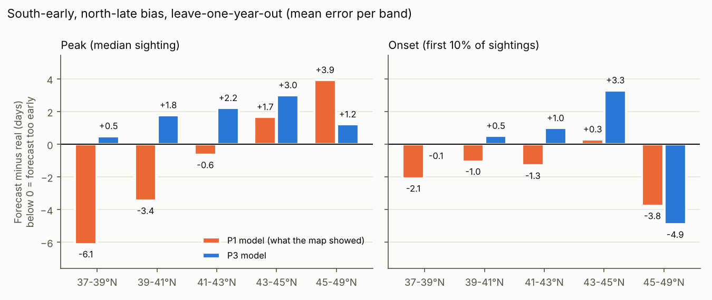
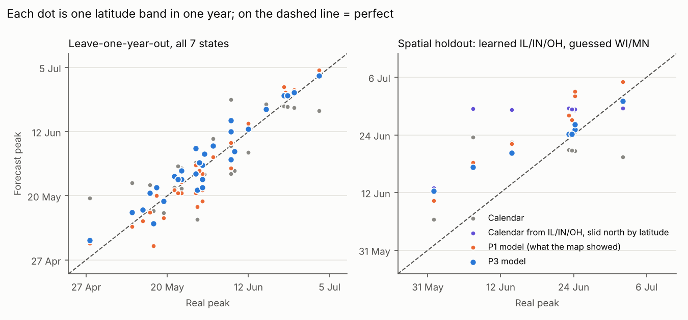

# P3.1 result: no daylength term, warmth targets at or above zero (2026-10-22)

**Outcome (2026-10-23): not adopted. The map stays on P3.** P3.1 tied P3 on past years and passed the WI/MN holdout as a second look. But on the 2026 season, the one test neither model had seen, it did clearly worse. As of 30 Sep, its sighting-weighted strip miss was 4.4-6.9 days against P3's 2.1-3.1 (the range is over three ways of summarising; see [DRYRUN_2026.md](../live/DRYRUN_2026.md)). It ran early in the south and late in the north. That is the lean the daylength term removes. It is one season and a rough check. Still, it is the only fresh evidence, so the pre-registered pick stays on the map. This overrides the amendment's own rule (on a tie, P3.1 goes on the map) using a check that was not written down in advance, and whose three summaries were chosen after seeing the results. Everything below is kept as the record.

**Verdict at the time (2026-10-22).**
- **Ties P3 on leave-one-year-out.** P3.1 is 3.77 days off on average, P3 (daylength) 3.85. The difference is noise (P3 minus P3.1: +0.05, 95% CI −0.23 to +0.33).
- **Still beats the calendar clearly** (7.31 d; better by 2.9, CI 0.9 to 5.0) and **ties P1** (4.05 d; CI −0.5 to +1.0).
- **Spatial holdout (learn IL/IN/OH, guess WI/MN): passes, but as a second look.** 5.1 days, against P1 6.3 (clearly better, CI 0.3 to 2.1), the latitude-slid calendar 10.7, and WI/MN's own calendar 6.9 (better, but the CI −0.9 to +4.7 includes zero). P3.1 was chosen *after* P3 failed this test and p3_flat scored 5.1 on it, so this is not a confirmation. Only 2026 can confirm it.
- **Targets stay above zero.** Location and skew are now bounded at ≥ 0 ([FROZEN_P3.md](FROZEN_P3.md), amendment). In every fold the bound is inactive (location 62-70 DD). But 9 of 120 bootstrap refits still went to a wide curve, now pinned at 0 instead of −500, with a median target of 400-470 DD. A full multi-start refit of those 9 found nothing better. So some resamples really do prefer that shape. They are kept in the ranges below.

| Leave-one-year-out (31 band-years) | Onset | Peak | Average |
|---|---|---|---|
| Calendar for that band | 7.9 d | 6.7 d | 7.31 d |
| P1 model | 3.9 d | 4.2 d | 4.05 d |
| P3 (daylength, the first pick) | 4.0 d | 3.7 d | 3.85 d |
| **P3.1** | **3.7 d** | **3.9 d** | **3.77 d** |

| Spatial holdout (8 WI/MN band-years) | Onset | Peak | Average |
|---|---|---|---|
| WI/MN's own calendar | 6.9 d | 7.0 d | 6.92 d |
| IL/IN/OH calendar slid north | 12.0 d | 9.4 d | 10.71 d |
| P1 model | 5.3 d | 7.2 d | 6.26 d |
| P3 (daylength) | 4.6 d | 10.2 d | 7.38 d |
| **P3.1 (second look)** | **6.0 d** | **4.2 d** | **5.08 d** |

**Bias by band** (mean forecast − real peak, days; below 0 = too early):

| Band | 37-39 °N | 39-41 | 41-43 | 43-45 | 45-49 °N |
|---|---|---|---|---|---|
| P1 / P2 map | −6.1 | −3.4 | −0.6 | +1.7 | +3.9 |
| P3 (daylength) | +0.5 | +1.8 | +2.2 | +3.0 | +1.2 |
| P3.1 | −1.1 | +1.4 | +2.4 | +3.7 | +2.9 |

The south/north bias shrank compared with P1 at both ends (the frozen rule). P3.1 leans late in the north more than P3 did (+2.9 vs +1.2 d at 45-49 °N). Its onset there runs 3.8 days early. Noise floor: 3.0 d (holdout 2.3 d).

- **Median warmth target:** 206 DD (95%: 197-449 resampling years, 197-446 resampling observers, with the 9 wide fits; 197-217 without them). The lower edge of the curve sits near 53 DD.
- **p3_flat vs P3.1.** Same model except the bounds. P3.1 scored 3.77, p3_flat 3.81: the bound never binds in a fold, but clipping the starting point into the bounds moved some folds to a slightly different optimum (difference CI −0.06 to +0.06).
- **The map moved little.** Hex dates changed by 0.7 days on average (5-95%: −1 to +2 days, at most 6). The typical-year peak moved about 1 day earlier in the far south and 1 day later in the far north. The 80% window is now peak −6 to +5 days, onset −5 to +6.
- Numbers: `results/p3_1/headline.json`. Figures: [bias](results/p3_1/figures/bias_by_band.png), [predicted vs real](results/p3_1/figures/predicted_vs_real.png). P3's run of record (run 2, the map's model) is in `results/` and `figures/`, run 1 in `results/run1_as_preregistered/`.

---

# P3 result: the fit (2026-10-22)

**Verdict.**
- **Beats the calendar: yes, clearly.** The P3 model calls luna onset and peak about 3.9 days off on average, against 7.3 days for the calendar (2.8 days better, 95% CI 1.0 to 4.7). Each year was guessed without seeing that year's moths.
- **Beats the old map model (P1): no, it ties.** P1's model scores 4.05 days. The 0.2-day difference is noise (CI −0.6 to +1.0).
- **South-early / north-late bias: mostly fixed.** The P2 map's peak ran 6.1 days early at 37-39 °N and 3.9 days late at 45-49 °N. P3 runs 0.5 and 1.2 days late there. It does lean 2-3 days late in the middle bands.
- **Latitude / daylength term: does not help.** The same model *without* it scores 3.81 days, as good as with it. The bias fix comes from the rest of the model, not from that term.
- **Spatial holdout (learn IL/IN/OH, guess WI/MN): FAILED** for the model chosen in advance. It scored 7.4 days. P1's model scored 6.3 and Wisconsin/Minnesota's own calendar 6.9. It did beat the "slide the southern calendar north" baseline (10.7 days).

Rules were written down before scoring: [FROZEN_P3.md](FROZEN_P3.md). How the model works: [README.md](README.md).

## The numbers

**Leave-one-year-out, all 7 states** (31 latitude band-years, ≥ 20 records each):

| Model | Onset error | Peak error | Average | vs P3 (95% CI) |
|---|---|---|---|---|
| Calendar for that band | 7.9 d | 6.7 d | 7.3 d | P3 better by 2.8 (1.0 to 4.7) |
| P1 model (what the map showed) | 3.9 d | 4.2 d | 4.05 d | P3 better by 0.2 (−0.6 to +1.0): a tie |
| **P3 (daylength version, the pre-registered pick)** | **4.0 d** | **3.7 d** | **3.85 d** | |
| P3 without the latitude/daylength term | 3.8 d | 3.9 d | 3.81 d | a tie (−0.3 to +0.2) |
| P3 with a bell curve instead of the skewed one | 6.7 d | 3.9 d | 5.3 d | P3 better by 1.3 (0.2 to 2.4) |

**Noise floor: about 3.0 d.** Each target is itself only known to about ±3.4 days (fewer than 200 records per band-year). So a *perfect* forecaster would still score about 3.0 days, and P3 sits about 0.8 days above that.

**Spatial holdout** (fit on IL/IN/OH only; 8 WI/MN band-years, 7 of them at 45-49 °N; noise floor 2.3 d):

| Model | Onset | Peak | Average |
|---|---|---|---|
| **P3 (daylength, the pre-registered pick)** | 4.6 d | **10.2 d** | **7.4 d: fails** |
| P1 model | 5.3 d | 7.2 d | 6.3 d |
| WI/MN's own calendar (uses local data the models never saw) | 6.9 d | 7.0 d | 6.9 d |
| IL/IN/OH calendar slid north by latitude | 12.0 d | 9.4 d | 10.7 d |
| *P3 without the latitude/daylength term (not the pick)* | 6.1 d | 4.2 d | *5.1 d* |

**Bias by band** (mean forecast − real peak, days; below 0 = too early):

| Band | 37-39 °N | 39-41 | 41-43 | 43-45 | 45-49 °N |
|---|---|---|---|---|---|
| P1 / P2 map | −6.1 | −3.4 | −0.6 | +1.7 | +3.9 |
| P3 (run 2) | +0.5 | +1.8 | +2.2 | +3.0 | +1.2 |
| P3.1 (not adopted) | −1.1 | +1.4 | +2.4 | +3.7 | +2.9 |

## What it means
- **Picture a bank account.** From 1 March, each warm day pays in degree-days, and each moth has its own savings target. The targets sit on a lopsided curve: nobody comes out before about 70 degree-days, half are out by about 220, and a long tail needs more. (In the daylength version these are daylength-weighted degree-days, within about 10-15% of plain ones in May-June.) Making the curve lopsided matters: a symmetric bell curve is 1.3 days worse.
- **Why the south/north bias shrank.** P1 assumed a moth is seen *at* its target. P3 adds three things:
  - an adult then flies for a week;
  - people log moths unevenly (weekends, Moth Week, the summer rise in moth-lighting), so the effort background is built in;
  - the first-brood window ends at a cut-off.

  In the hot south a week of flying banks far more warmth than in the north. That is the likely reason southern sightings "show" more saved-up warmth. The model without any latitude term shrinks the bias too (−1.1 d south, +2.8 d north), so the moths don't seem to need different targets.
- **Daylength / latitude.** The daylength version won the pre-registered choice on IL/IN/OH by a hair, in likelihood terms. It doesn't forecast dates any better than leaving the term out. Fitted on IL/IN/OH alone, its daylength effect flips sign (γ = −1.9, against +0.66 in the all-states fit). Carried north into Minnesota, that pushed the peak about 10 days late. That is why the holdout failed. Like a ruler calibrated on three states, it bends when you carry it north.
- **Two runs, both reported.** Run 1 (as pre-registered) found a poor local optimum in some fits. Fixing the optimiser changed the result to the one shown here (the change log has details). Run 1 scored 4.27 d leave-one-year-out and 9.8 d in the holdout. The fix came after seeing run 1, so treat run 2's holdout as a second look, not a first.
- **The map** used P3's leave-one-year-out forecast (P3.1's since the amendment above). Each year comes from a fit that never saw it. Each hex shows when its expected *sightings* happen, the quantity that was scored. Without the effort shape and the cut-off, the hidden "moths flying" curve runs up to two weeks earlier in the south, and nothing in the data can check it. It also carries an 80% band from past errors: peak −6 to +4 days, onset −5 to +6.

## What's still unproven
- **A season the model has never seen.** 2026 is the real test, once Daymet 2026 is out (around mid-2027).
- **Whether the effort background is fair.** "All moths logged that day" also rises with moth *abundance* in July, not just with observers. The fit without effort scores about the same (3.96 d leave-one-year-out).
- **The north.** The holdout has only 8 band-years, almost all from 45-49 °N. The no-term model did well there (5.1 d), but it was not the pick, so that is a hint, not a result.
- **Deferred:**
  - air vs soil warmth (needs ERA5-Land via Open-Meteo, blocked here);
  - a night-only, per-hex effort background (the histogram endpoint can't do it);
  - research grade + needs-ID;
  - urban vs rural.
- **Recommendation for P4:** drop the latitude/daylength term (simpler, ties on leave-one-year-out, did better in the holdout), and re-confirm on 2026.

## Parameter intervals (bootstrap refits, 60 over years and 60 over observers)
- Median warmth target: about 220 degree-days (95%: 200-238 resampling years, 185-252 resampling observers).
- Daylength exponent γ: 0.55 (−0.42 to 0.93 over years; −0.94 to 1.37 over observers). It is consistent with zero.
- 11 of 120 refits went to a degenerate fit and are left out of those ranges. They are kept in `results/bootstrap_refits.csv`. (Note that its `headline.json` `param_intervals` still includes them, so its ranges differ from these.) Review found what they are: the curve's location parameter stuck at its −500 bound with a median target near −225 degree-days. Nothing in the likelihood keeps targets above zero, because the curve is renormalised per place-year. All 11 have γ < 0, so leaving them out is not neutral. P3.1 (above) bounds them, but was not adopted.
- `headline.json` `mae_ci` (resampling observers) does not contain the point estimates, because resampling also adds noise to the targets. Don't quote it. Use the CIs in the tables above.
- Two places where held-out data touches the method, both small: (1) the daylength-vs-latitude choice used IL/IN/OH likelihoods from all 11 years, so the LOYO score of the chosen model isn't strictly nested (3.86 vs 3.85 d either way). (2) In the holdout, the WI/MN brood cut-offs, hex weights and effort shape come from WI/MN's other years (for P1 too). "Never sees a WI/MN record" holds for fitting only.
