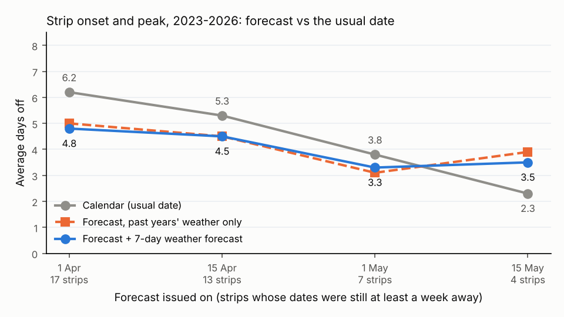

# How far ahead is the live map useful? (lead-time backtest, built 2026-10-24)

The live map is a forecast made each morning from real weather so far, a 7-day weather forecast, and past years'
weather for the rest of the spring. This note asks two things: how much better than the usual date is it when it is
issued weeks ahead, and how much does the 7-day weather forecast add? Script: [`leadtime.py`](leadtime.py).
Numbers: [`leadtime.json`](leadtime.json). The frozen P3 model was not refit or changed, and neither was the map.

**Answer.** From 1 April on, the strip forecast beats the usual date by about half a day to a day and a half on
average (4.8 against 6.2 days off on 1 April, 4.5 against 5.3 on 15 April, 3.3 against 3.8 on 1 May). That is a
modest edge, it is already there on 1 April (1 to 11 weeks before a strip's dates), and it does not grow as the date gets closer. By mid-May only
the northern strip is still ahead, and there the usual date is hard to beat. **The 7-day weather forecast adds almost
nothing:** it moves a strip's error by about half a day either way and does not change the average. Even a perfect
7-day forecast (the real weather) would add at most about 0.3 days.

| Issued on | Strips graded | Usual date (calendar) | Forecast, past years' weather only | Forecast + 7-day weather forecast | Forecast + perfect 7 days | Strips where the forecast won |
|---|---|---|---|---|---|---|
| 1 April | 17 | 6.2 | 5.0 | **4.8** | 4.7 | 12 of 17 |
| 15 April | 13 | 5.3 | 4.5 | **4.5** | 4.3 | 8 of 13 |
| 1 May | 7 | 3.8 | 3.1 | **3.3** | 3.1 | 4 of 7 |
| 15 May | 4 | **2.3** | 3.9 | 3.5 | 4.2 | 1 of 4 |
| 1 June | 0 | - | - | - | - | - |

Average days off, over each strip's first-wave onset and peak, seasons 2023 to 2026 pooled. "Won" counts the forecast
with the 7-day weather forecast. A strip is graded on an issue date only if both of its real dates were still at
least a week away, the scorecard's rule, so later rows hold fewer and more northern strips. By 1 June every strip's
first moths had already come, so nothing is graded.



In plain words:
- **"How many weeks ahead?"** There is no clear horizon. The edge is there from 1 April and is about the same size
  at every lead: grouped by how far ahead each date was, the forecast is 0.4 to 0.7 days better than
  the usual date at 2 to 9 weeks ahead. In the last 1 to 2 weeks before a date it was 3.3 against 8.9 days, but only
  7 dates (all onsets) are that close, and two 2026 dates where the usual date was 17 days off carry most of the
  gap. More than 9 weeks ahead the usual date is slightly better (2.1 against 2.4).
- **Why it barely sharpens.** Weeks of real weather do help, but the model's own error (about 4 days on past years)
  stays once the weather is known. The usual date's error shrinks too as the rows move north, since the north was
  near-normal in these years.
- **When it helps most: unusual springs.** 2024 (early): 4.9 days against 6.8. 2026 (early in the middle states):
  4.1 against 5.2. In ordinary years (2023, 2025) it ties the usual date (3.6 against 3.9, 4.6 against 4.7).
- **The 7-day forecast.** Replacing it with past years' weather changed the average by 0.07 days (0.6 days per strip
  either way, at most 2.5). One week out of a spring of weather moves a date little, and past years' weather is a
  fair guess for a single week. It is cheap and harmless, but it is not where the skill comes from.
- **Rough uncertainty.** Resampling the four seasons, the 1 April gain is 0.8 to 2.2 days (95%) and the 15 April
  gain 0.2 to 1.5 days. Four seasons is very few, so read these as rough.

## How it was done
- **Seasons and dates.** 2023, 2024, 2025 and 2026, each issued on 1 April, 15 April, 1 May, 15 May and 1 June, with
  real weather through the day before (as the nightly job, which runs in the morning).
- **Real weather so far:** PRISM via RCC-ACIS with the Daymet offsets, exactly as `build_live.py` does (it was not
  blocked).
- **The 7-day forecast:** Open-Meteo's Historical Forecast API was the plan, but it refused every request from here
  ("daily API request limit exceeded"; the archive and previous-runs endpoints too). So the stand-in is NOAA's own
  GFS, the 00Z run of each issue day from its public AWS archive (0.5°, 2 m max and min temperature over 6-hour
  windows, read at each hex centre), days 1 to 7, with the same Daymet offsets the live job adds to Open-Meteo. This is
  closer to "what the forecast said that night" than the Historical Forecast API, which stitches together the first
  hours of many runs. GFS ran about 1.9 °C cool on daily highs against PRISM here (lows about right); left as is, as
  the live job does.
- **Perfect 7 days:** the real PRISM weather for the same 7 days, the most any 7-day forecast could add.
- **No peeking for 2023-2025.** The frozen model was fitted on 2015-2025. For a fitted year only the fit that left
  that year out is used (1 fit x 10 weather endings), that year's own weather is dropped from the endings, and the
  calendar, the likely-range widening and the strip weights come from the other years only. 2026 runs exactly as the
  live job would (11 fits x 11 endings).
- **Grading** is `scorecard.py`'s own `first_wave` and `score_band`: research-grade iNaturalist records with the
  fit's filters, first wave only, at least 20 per strip; real onset / peak = 10th percentile / median day; a forecast
  is graded only if issued at least 7 days before the real date. Records were pulled 24 Oct 2026. For 2023-2025 the
  real dates match the replay's scored ones to within a day, except 2025 at 41-43 °N (peak 4 days) and 43-45 °N
  (onset 2.6 days), where records have changed since the fit's pull. Calendar = the strip's mean onset and peak over the other scored years.

## Caveats
- 4 seasons, 41 graded strips, and the strips within a season share one spring. 43-45 °N had too few records in 2023.
- 37-39 °N is graded only in 2023 and 2025: in early years its first moths come before 8 April, too soon after
  1 April. That is the strip `SCORECARD_2026.md` found hardest.
- The 2026 rows differ from `SCORECARD_2026.md`: that grades each date on the newest weekly forecast at least a week
  before it; this fixes the issue date.
- GFS is not Open-Meteo's mix of models. The perfect-7-days column shows the answer would not change with a better
  forecast.
- **Found along the way (not fixed here):** PRISM's daily high is filed one day later than the calendar day it
  happened on. GFS and Daymet highs both match PRISM's *next* date (Daymet vs PRISM, 2023-2025: 0.6 °C apart shifted a
  day, 3.5 °C as filed; lows line up as filed). So the live job credits each afternoon's warmth a day late and the
  forecast's first day repeats a high. In spring that is worth well under a day, but `sources.py`'s weather-day rule
  could shift PRISM highs back a day; that changes the live forecast, so it is left for its own change.

## Reproduce
```
pip install pygrib                 # reads the GFS files
python3 pipeline/live/leadtime.py  # writes leadtime.json and leadtime.png
python3 -m pytest pipeline/live/test_leadtime.py
```
Downloads are cached in `notebooks/data/` (gitignored): PRISM per season (`prism_<year>.npz`, 551 ACIS calls each),
records (`luna_<year>_rg.parquet`), the 20 GFS weeks and the 60 rebuilt forecasts (`leadtime/`). With the Daymet cache
in place, a full run takes about 20 minutes, mostly the 60 forecast rebuilds.
